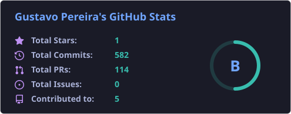
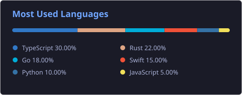

## Gustavo Pereira

  
  

## Tecnologias

    

 

Apaixonado por tecnologia e sempre em busca de aprimorar minhas habilidades e meu desenvolvimento pessoal.

## Contatos

- [📧 contatogustavopc@gmail.com](mailto:contatogustavopc@gmail.com "Envie um e-mail para mim")
